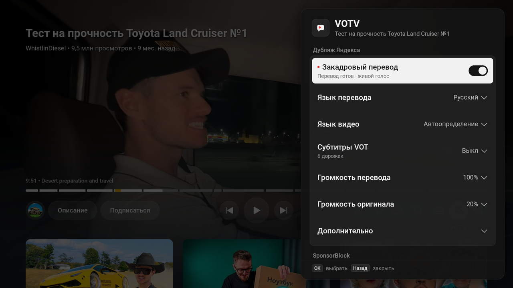

<p align="center">
  <strong>Русский</strong> ·
  <a href="docs/i18n/README.en.md">English</a> ·
  <a href="docs/i18n/README.zh.md">中文</a> ·
  <a href="docs/i18n/README.es.md">Español</a> ·
  <a href="docs/i18n/README.hi.md">हिन्दी</a> ·
  <a href="docs/i18n/README.ar.md">العربية</a> ·
  <a href="docs/i18n/README.pt.md">Português</a> ·
  <a href="docs/i18n/README.fr.md">Français</a> ·
  <a href="docs/i18n/README.de.md">Deutsch</a> ·
  <a href="docs/i18n/README.ja.md">日本語</a>
</p>

<p align="center">
  
</p>

# VOTV

Патчи и JavaScript-плагины для официального **YouTube для Android TV (8.02.300)**: закадровый перевод Яндекса, SponsorBlock и отключение рекламы.

[sadthers.dev](https://sadthers.dev) · [Релизы плагинов](https://github.com/leon03131/votv/releases) · [Тесты CI](https://github.com/leon03131/votv/actions/workflows/test.yml) · YouTube TV `8.02.300` · [GPL-3.0](LICENSE)

---

## Возможности

- **Закадровый перевод Яндекса (`@vot.js/core`)** — перевод видео на русский, английский и казахский языки. На стороне Java-хоста работает отдельный `AudioPlayer` с плавной подстройкой скорости, независимой громкостью перевода и оригинала, поддержкой субтитров VOT и фоновой обработкой `PART_CONTENT` / `AUDIO_REQUESTED`. При ошибке сессии на «живых голосах» срабатывает откат на стандартный голос и прокси VOT.
- **SponsorBlock** — поиск сегментов по SHA-256 префиксу через [API SponsorBlock](https://sponsor.ajay.app/). Отрезки рисуются поверх стандартной шкалы и шкалы с главами, не пропадают при перерисовках Incremental DOM, поддерживают автопропуск, склейку смежных сегментов, ручной пропуск и перемотку назад внутри сегмента без повторного срабатывания.
- **Отключение рекламы** — удаление рекламных блоков из ответов плеера и лент рекомендаций.
- **Интерфейс под пульт ТВ** — боковая панель VOTV в плеере (язык, голос, субтитры, громкость, быстрые переключатели) и встроенный раздел настроек внутри меню YouTube. Варианты выбора рендерятся прямо в правой панели без всплывающих окон и сброса фокуса.
- **Обновление плагинов** — загрузка `bundle.js` и `manifest.json` из GitHub Releases с проверкой SHA-256 и автоматическим откатом после 3 неудачных запусков, без переустановки APK.
- **Установка рядом с оригиналом** — собственный идентификатор пакета `app.votv.youtube`, root не требуется. Вход в аккаунт через `yt.be/activate` или microG (`app.revanced.android.gms`).

## Скриншоты

<table>
  <tr>
    <td align="center" width="50%">
      <br>
      <sub>Боковая панель VOTV в плеере</sub>
    </td>
    <td align="center" width="50%">
      <br>
      <sub>Разметка SponsorBlock на шкале с главами</sub>
    </td>
  </tr>
  <tr>
    <td align="center" width="50%">
      <br>
      <sub>Настройки выбора в правой панели</sub>
    </td>
    <td align="center" width="50%">
      <br>
      <sub>Переключатели в разделе «Настройки»</sub>
    </td>
  </tr>
</table>

## Готовые APK

В репозитории и GitHub Releases публикуются только исходный код, патчи и бандл JS-плагинов (`bundle.js`, `manifest.json`). Готовые APK здесь не размещаются по соображениям авторских прав — они будут выложены на [sadthers.dev](https://sadthers.dev).

## Сборка

Скрипт [`build/build.py`](build/build.py) автоматически определяет архитектуры в папке [`input/`](input/README.md), скачивает `apktool` при его отсутствии, собирает `@vot.js/core` для плагина перевода и создаёт локальный ключ подписи, если он не задан.

**Требования:** Python 3.10+ (с `Pillow` для тестов/рендера иконок), Node.js 20+, Java JDK 17+ (`java`, `javac`, `keytool`), Android SDK (`build-tools` 35+ и любая `platforms/android-*`).

1. Клонируйте репозиторий:
   ```bash
   git clone https://github.com/leon03131/votv.git
   cd votv
   ```

2. Поместите оригинальный APK YouTube для Android TV (`com.google.android.youtube.tv`, версия `8.02.300`) в папку `input/` — для одной нужной архитектуры (`arm`, `arm64`, `x86`) или сразу для нескольких.

3. Запустите сборку:
   - Windows: запустите [`build.bat`](build.bat)
   - Linux / macOS: `./build.sh`

Подписанные APK появятся в `dist/` (`votv-8.02.300-votv.8-arm.apk`, `arm64`, `x86`).

<details>
<summary>Параметры командной строки build/build.py</summary>

```bash
python build/build.py \
  --input path/to/apks \
  --abi arm arm64 \
  --apktool path/to/apktool.jar \
  --sdk path/to/Android/Sdk \
  --keystore path/to/votv.jks \
  --keypass-file path/to/votv.pass \
  --out dist
```

</details>

## Структура

```text
votv/
├── build/          Сборщик (build.py) и конфигурация целевой версии (config.json)
├── input/          Папка для оригинальных APK YouTube TV (.gitignore)
├── patches/        Smali и manifest-патчи (package_name, gms, client_id, primes, branding, host_bridge)
├── host/           Java-хост: мост __votv, HTTP без CORS, AudioPlayer, OTA-обновление плагинов
├── plugins/        JS-ядро (core/) и плагины (vot, sponsorblock, adblock, votv, diag)
├── branding/       SVG-исходники и растровые иконки/баннеры Android TV
├── dev/            Локальный dev-сервер (serve.py) и E2E-скрипт для устройства (e2e.py)
├── tests/          Тесты патчей, бандлера, JS-плагинов и собранных APK
├── build.bat       Скрипт сборки для Windows
└── build.sh        Скрипт сборки для Linux / macOS
```

## Разработка и тесты

**Режим разработчика** (подгрузка плагинов с ПК без пересборки APK):

```bash
python dev/serve.py
adb shell setprop debug.votv.dev http://<IP_ПК>:8080   # для эмулятора: http://10.0.2.2:8080
adb shell am force-stop app.votv.youtube
adb logcat -s VOTV
```

Выключить dev-режим: `adb shell setprop debug.votv.dev ""`

**Тесты:**

```bash
npm ci
npm run build:vot
npm test                                  # JS: 61 тест
python -m unittest discover -s tests -v   # Python: 37 тестов
```

## Благодарности

- [ilyhalight/voice-over-translation](https://github.com/ilyhalight/voice-over-translation) и [FOSWLY/vot.js](https://github.com/FOSWLY/vot.js) — голосовой перевод (MIT)
- [ajayyy/SponsorBlock](https://github.com/ajayyy/SponsorBlock) и [sponsor.ajay.app](https://sponsor.ajay.app/) — база сегментов (CC BY-NC-SA 4.0)
- [ReVanced](https://github.com/ReVanced) — поддержка GmsCore/microG
- [Apktool](https://apktool.org/) — разбор и сборка APK

## Лицензия

[GPL-3.0](LICENSE). Проект не связан с Google, YouTube или Яндексом.
