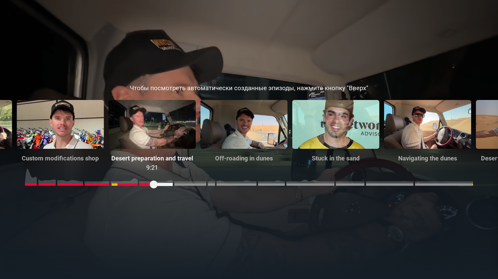

  <a href="../../README.md">Русский</a> ·
  <a href="README.en.md">English</a> ·
  <a href="README.zh.md">中文</a> ·
  <a href="README.es.md">Español</a> ·
  <a href="README.hi.md">हिन्दी</a> ·
  <a href="README.ar.md">العربية</a> ·
  <a href="README.pt.md">Português</a> ·
  <a href="README.fr.md">Français</a> ·
  <strong>Deutsch</strong> ·
  <a href="README.ja.md">日本語</a>

  

# VOTV

Patches und JavaScript-Plugins für das offizielle **YouTube für Android TV (8.02.300)**: Yandex-Sprachübersetzung, SponsorBlock und Werbeentfernung.

[sadthers.dev](https://sadthers.dev) · [Plugin-Releases](https://github.com/leon03131/votv/releases) · [CI-Tests](https://github.com/leon03131/votv/actions/workflows/test.yml) · YouTube TV `8.02.300` · [GPL-3.0](../../LICENSE)

---

## Funktionen

- **Yandex-Voice-Over (`@vot.js/core`)** — Sprachübersetzung ins Russische, Englische oder Kasachische über einen nativen Java-`AudioPlayer` mit Tempo-Synchronisation, getrennter Lautstärkeregelung, VOT-Untertiteln und automatischem Fallback.
- **SponsorBlock** — Segmentmarkierungen auf der Fortschritts- und Kapitelleiste, Auto-Skip, verkettete Segmente, manuelle Skip-Abfrage und sauberer Rückspul-Umgang.
- **Werbefrei** — entfernt Werbeanzeigen aus Player-Antworten und Video-Feeds.
- **TV-Fernbedienungs-UI** — Seitenpanel im Player sowie direkt in den YouTube-Einstellungen integrierte Inline-Optionen ohne Fokusverlust.
- **Plugin-Updates** — lädt `bundle.js` und `manifest.json` mit SHA-256-Prüfung aus GitHub Releases ohne APK-Neuinstallation.
- **Parallele Installation** — Paket-ID `app.votv.youtube`, kein Root nötig, Anmeldung über `yt.be/activate` oder microG.

## Screenshots

<table>
  <tr>
    <td align="center" width="50%"> VOTV-Seitenpanel im Player</td>
    <td align="center" width="50%"> SponsorBlock-Markierungen in der Kapitelleiste</td>
  </tr>
  <tr>
    <td align="center" width="50%"> Inline-Auswahl in den Einstellungen</td>
    <td align="center" width="50%"> Native Schalter in YouTube TV</td>
  </tr>
</table>

## APKs & Build

Auf GitHub liegen ausschließlich Quellcode, Patches und JS-Plugin-Bundles (`bundle.js`, `manifest.json`). Fertige APKs erscheinen auf [sadthers.dev](https://sadthers.dev).

**Lokaler Build** (Python 3.10+, Node.js 20+, JDK 17+, Android SDK build-tools 35+):
1. `git clone https://github.com/leon03131/votv.git && cd votv`
2. Original-APK(s) von YouTube für Android TV (`8.02.300`, `arm` / `arm64` / `x86`) in `input/` ablegen.
3. `build.bat` (Windows) oder `./build.sh` (Linux/macOS) ausführen; signierte APKs landen in `dist/`.

## Lizenz

[GPL-3.0](../../LICENSE). Nicht mit Google, YouTube oder Yandex verbunden.
