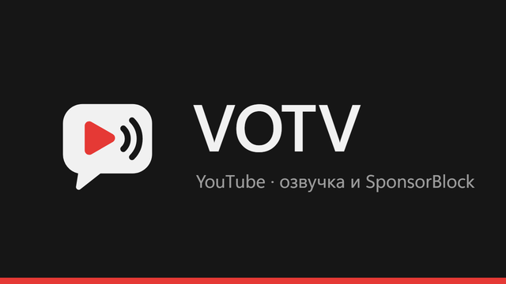

  <a href="../../README.md">Русский</a> ·
  <a href="README.en.md">English</a> ·
  <a href="README.zh.md">中文</a> ·
  <a href="README.es.md">Español</a> ·
  <a href="README.hi.md">हिन्दी</a> ·
  <a href="README.ar.md">العربية</a> ·
  <a href="README.pt.md">Português</a> ·
  <a href="README.fr.md">Français</a> ·
  <a href="README.de.md">Deutsch</a> ·
  <strong>日本語</strong>

  

# VOTV

公式 **YouTube for Android TV (8.02.300)** 向けパッチ＆JavaScript プラグイン集：Yandex 音声吹替、SponsorBlock、広告削除に対応しています。

[sadthers.dev](https://sadthers.dev) · [プラグインリリース](https://github.com/leon03131/votv/releases) · [CI テスト](https://github.com/leon03131/votv/actions/workflows/test.yml) · YouTube TV `8.02.300` · [GPL-3.0](../../LICENSE)

---

## 主な機能

- **Yandex 音声翻訳 (`@vot.js/core`)** — ロシア語・英語・カザフ語への音声翻訳。Java ホスト側のネイティブ `AudioPlayer` により速度同期、翻訳/元音声の独立音量調整、VOT 字幕、自動フォールバックを行います。
- **SponsorBlock** — 通常シークバーおよびチャプターバー上へのセグメント描画、自動スキップ、連続セグメント結合、手動スキップ表示、巻き戻し処理に対応。
- **広告削除** — プレーヤー応答やフィードから広告を除去します。
- **リモコン操作 UI** — プレーヤー内のサイドパネルと、YouTube 設定画面内に統合されたインライン選択肢（フォーカス戻りの不具合なし）。
- **プラグイン更新** — APK を再インストールせず、GitHub Releases から SHA-256 検証付きで `bundle.js` と `manifest.json` を更新します。
- **併用インストール** — パッケージ名 `app.votv.youtube`、Root 不要、`yt.be/activate` または microG でログイン可能。

## スクリーンショット

<table>
  <tr>
    <td align="center" width="50%"> プレーヤー内の VOTV サイドパネル</td>
    <td align="center" width="50%"> チャプターバー上の SponsorBlock マーカー</td>
  </tr>
  <tr>
    <td align="center" width="50%"> 設定画面のインライン選択肢</td>
    <td align="center" width="50%"> YouTube TV ネイティブ風のトグル設定</td>
  </tr>
</table>

## APK とビルド

GitHub にはソースコード、パッチ、JS プラグインバンドル（`bundle.js`、`manifest.json`）のみを公開しています。ビルド済み APK は [sadthers.dev](https://sadthers.dev) にて配布予定です。

**ローカルビルド手順**（Python 3.10+, Node.js 20+, JDK 17+, Android SDK build-tools 35+）：
1. `git clone https://github.com/leon03131/votv.git && cd votv`
2. 純正 YouTube for Android TV（`8.02.300`、`arm` / `arm64` / `x86`）の APK を `input/` に配置。
3. Windows は `build.bat`、Linux/macOS は `./build.sh` を実行すると、`dist/` に署名済み APK が生成されます。

## ライセンス

[GPL-3.0](../../LICENSE)。Google、YouTube、Yandex とは無関係です。
