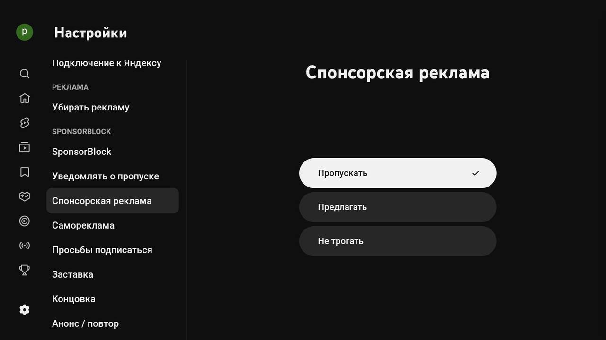
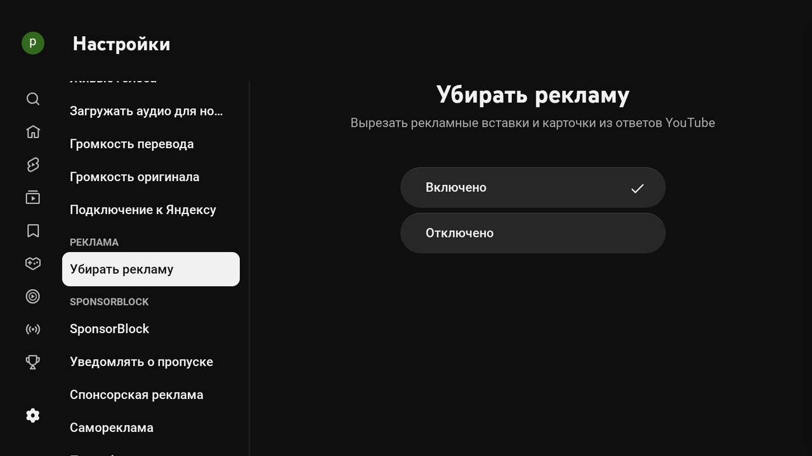

  <a href="../../README.md">Русский</a> ·
  <a href="README.en.md">English</a> ·
  <a href="README.zh.md">中文</a> ·
  <a href="README.es.md">Español</a> ·
  <a href="README.hi.md">हिन्दी</a> ·
  <a href="README.ar.md">العربية</a> ·
  <strong>Português</strong> ·
  <a href="README.fr.md">Français</a> ·
  <a href="README.de.md">Deutsch</a> ·
  <a href="README.ja.md">日本語</a>

  

# VOTV

Patches e plugins JavaScript para o **YouTube for Android TV (8.02.300)** oficial: dublagem da Yandex, SponsorBlock e remoção de anúncios.

[sadthers.dev](https://sadthers.dev) · [Releases de plugins](https://github.com/leon03131/votv/releases) · [Testes CI](https://github.com/leon03131/votv/actions/workflows/test.yml) · YouTube TV `8.02.300` · [GPL-3.0](../../LICENSE)

---

## Recursos

- **Dublagem da Yandex (`@vot.js/core`)** — tradução de voz para russo, inglês ou cazaque com `AudioPlayer` nativo em Java, sincronização suave, controle separado de volume, legendas VOT e fallback automático.
- **SponsorBlock** — marcadores sobre a barra de progresso e capítulos, pulo automático, segmentos encadeados, aviso manual e tratamento ao retroceder.
- **Sem anúncios** — remove anúncios das respostas do player e feeds.
- **Interface para controle remoto** — painel lateral no player e configurações inline integradas ao menu do YouTube TV sem perda de foco.
- **Atualização de plugins** — baixa `bundle.js` e `manifest.json` via GitHub Releases com verificação SHA-256 sem reinstalar o APK.
- **Instalação paralela** — pacote `app.votv.youtube`, sem root, login via `yt.be/activate` ou microG.

## Capturas

<table>
  <tr>
    <td align="center" width="50%"> Painel lateral VOTV no player</td>
    <td align="center" width="50%"> Marcadores SponsorBlock na barra de capítulos</td>
  </tr>
  <tr>
    <td align="center" width="50%"> Opções inline em Configurações</td>
    <td align="center" width="50%"> Alternadores nativos no YouTube TV</td>
  </tr>
</table>

## APKs e compilação

O GitHub hospeda apenas o código-fonte, patches e pacotes JS (`bundle.js`, `manifest.json`). Os APKs compilados estarão disponíveis em [sadthers.dev](https://sadthers.dev).

**Compilação local** (Python 3.10+, Node.js 20+, JDK 17+, Android SDK build-tools 35+):
1. `git clone https://github.com/leon03131/votv.git && cd votv`
2. Coloque os APKs originais do YouTube for Android TV (`8.02.300`, `arm` / `arm64` / `x86`) em `input/`.
3. Execute `build.bat` (Windows) ou `./build.sh` (Linux/macOS); os APKs assinados serão gravados em `dist/`.

## Licença

[GPL-3.0](../../LICENSE). Sem vínculo com Google, YouTube ou Yandex.
